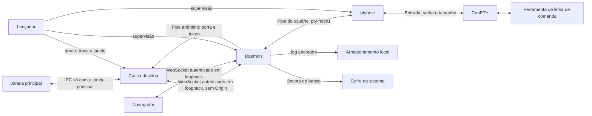

# Arquitetura local

O fluxo local no Windows usa processos separados para manter os terminais ativos durante reinícios do daemon. A interface roda na janela da casca desktop ou, no modo navegador, numa aba. O estado de cada módulo está no [mapa de módulos](modules.md).

## Fronteiras de confiança

- **Casca, janela e daemon.** No modo desktop, o lançador liga a saída padrão do daemon à entrada padrão da casca por um pipe anônimo, e só por ele o daemon entrega porta e token. O Rust da casca guarda o token, autentica no WebSocket e repassa mensagens por IPC somente à janela principal; o JavaScript da janela nunca recebe a credencial. O daemon recusa qualquer `Origin` nesse modo, porque `http://tauri.localhost` é compartilhada com outras páginas. Veja a [ADR 0020](adr/0020-local-api-authentication.md), o [modo desktop do daemon](../crates/daemon/README.md#modo-desktop), o [README da casca](../crates/shell/README.md) e o [risco da origem compartilhada](risks.md#origem-da-webview-compartilhada-no-windows).
- **Navegador e daemon.** No modo navegador, o daemon confere `Host` e `Origin` no upgrade e exige o token da execução em `auth.hello` antes de aceitar comandos. Quem abre a URL de conexão precisa conferir que o servidor da interface pertence à própria conta. Veja a [ADR 0020](adr/0020-local-api-authentication.md) e o [risco da porta da interface](risks.md#outro-usuário-ocupa-a-porta-da-interface).
- **Daemon e ptyhost.** No Windows, o host restringe o pipe ao usuário. Antes de enviar mensagens, o cliente confere a identidade do processo servidor e o dono do objeto do pipe. O host mantém sessões e replay em memória, independentemente da conexão do daemon. Veja a [ADR 0003](adr/0003-separate-pty-host-process.md) e o [canal do host](../crates/ptyhost/README.md#como-roda).
- **Host e ferramenta.** O daemon prepara a abertura usando configuração local e a política do núcleo. O host inicia o executável via ConPTY com o ambiente do pedido. A ferramenta roda com as permissões do usuário. Veja a [fronteira das credenciais](risks.md#credencial-de-cli-de-ia-vaza-para-o-processo-filho).
- **Armazenamento.** O módulo grava eventos num log só-anexo, com dados cifrados e cadeia com chave. Na biblioteca do daemon, a composição abre o banco canônico com a âncora no cofre do sistema, que recusa corte, cópia antiga ou troca do banco, e o diário do portão grava no log ancorado ([âncora no cofre](../crates/storage/README.md#âncora-no-cofre)). O que ainda falta está no [mapa de módulos](modules.md). Veja as ADRs [0004](adr/0004-local-sqlite-no-cloud-database.md), [0005](adr/0005-column-level-encryption.md) e [0021](adr/0021-storage-atomic-file-and-cipher.md).
- **Lançador.** O lançador supervisiona o daemon e o host de terminais. No Windows, ele também abre a casca e a substitui quando o daemon renasce com nova porta e novo token; se a casca sair, daemon e host continuam, e outra janela pede o sinal `restart`. O [README do lançador](../crates/launcher/README.md) descreve o comportamento atual e as pendências. A atualização com verificação de artefato está prevista na [ADR 0015](adr/0015-ci-built-artifact-with-verified-self-update.md).
