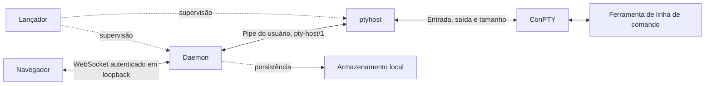

# Arquitetura local

O fluxo local no Windows usa processos separados para manter os terminais ativos durante reinícios do daemon. As linhas tracejadas indicam integrações previstas. O estado de cada módulo está no [mapa de módulos](modules.md).

## Fronteiras de confiança

- **Navegador e daemon.** O daemon confere `Host` e `Origin` no upgrade e exige o token da execução em `auth.hello` antes de aceitar comandos. Quem abre a URL de conexão precisa conferir que o servidor da interface pertence à própria conta. Veja a [ADR 0020](adr/0020-local-api-authentication.md) e o [risco da porta da interface](risks.md#outro-usuário-ocupa-a-porta-da-interface).
- **Casca e daemon.** A casca recebe a porta e o token da execução pelo pipe herdado. No upgrade WebSocket, verifica a prova de que o outro lado conhece o token e está na mesma conexão TCP. Só então envia `auth.hello` e encaminha os comandos da janela. Veja o [contrato da prova](../contracts/README.md#prova-do-daemon-no-desktop).
- **Daemon e ptyhost.** No Windows, o host restringe o pipe ao usuário. Antes de enviar mensagens, o cliente confere a identidade do processo servidor e o dono do objeto do pipe. O host mantém sessões e replay em memória, independentemente da conexão do daemon. Veja a [ADR 0003](adr/0003-separate-pty-host-process.md) e o [canal do host](../crates/ptyhost/README.md#como-roda).
- **Host e ferramenta.** O daemon prepara a abertura usando configuração local e a política do núcleo. O host inicia o executável via ConPTY com o ambiente do pedido. A ferramenta roda com as permissões do usuário. Veja a [fronteira das credenciais](risks.md#credencial-de-cli-de-ia-vaza-para-o-processo-filho).
- **Armazenamento.** O módulo abre o banco local e grava eventos com dados cifrados e cadeia com chave. A ligação com o daemon e a integração da chave com o cofre estão pendentes. Veja as ADRs [0004](adr/0004-local-sqlite-no-cloud-database.md), [0005](adr/0005-column-level-encryption.md) e [0021](adr/0021-storage-atomic-file-and-cipher.md).
- **Lançador.** O lançador supervisiona o daemon e o host de terminais. O [README do lançador](../crates/launcher/README.md) descreve o comportamento atual e as pendências. A atualização com verificação de artefato está prevista na [ADR 0015](adr/0015-ci-built-artifact-with-verified-self-update.md).
